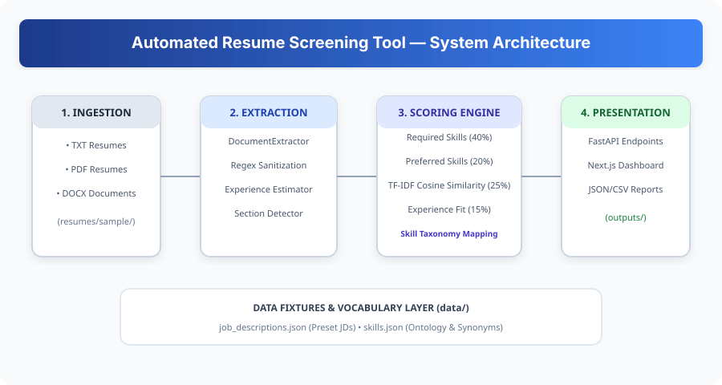

# Automated Resume Screening Tool

A decoupled candidate evaluation platform featuring a FastAPI backend service and a Next.js recruiter interface. The platform parses multi-format candidate resumes, evaluates text overlap and technical competencies against job specifications using Natural Language Processing techniques, and produces prioritized candidate rankings.

---

## System Architecture and Visual Walkthrough

The platform modularizes document ingestion, natural language processing, scoring algorithms, and presentation.

### System Architecture



### Recruiter Web Interface

#### 1. Job Role Selection and Configuration
Recruiters select target roles, view mandatory skill requirements, and upload resumes for batch screening.


#### 2. Candidate Parsing and Skill Match Breakdown
The dashboard processes uploaded resumes, displays matched versus missing competencies, and presents extracted candidate profiles.


#### 3. Candidate Ranking Leaderboard
Candidates are ranked based on composite multi-factor scores with clear fit classifications (Strong Match, Moderate Match, Weak Match).


---

## System Overview

### Core Components

1. Ingestion Layer:
   Extracts text content from PDF, DOCX, and plain text files. Fallback parsing mechanisms ensure text extraction even when optional binary parsers encounter formatting anomalies.

2. Matching and Evaluation Layer:
   Evaluates extracted text against structured skill taxonomies and job descriptions. Utilizes boundary-aware regular expressions to capture skills with specialized punctuation (such as C++, C#, and Scikit-learn) without false-positive subword matches.

3. Multi-Factor Scoring Engine:
   Computes a composite compatibility score on a 0 to 100 scale using four weighted components:
   - Required Skill Coverage (40 percent): Proportion of mandatory technical proficiencies detected.
   - Preferred Skill Coverage (20 percent): Proportion of secondary qualifications detected.
   - TF-IDF Cosine Similarity (25 percent): Text similarity between the resume text and the job description.
   - Experience Alignment (15 percent): Evaluates detected professional experience against minimum years required.

4. Candidate Fit Categorization:
   - Strong Match: Overall score at or above 70 percent.
   - Moderate Match: Overall score between 50 and 69 percent.
   - Weak Match: Overall score below 50 percent.
   - Gaps in mandatory skills downgrade the candidate status to human review to prevent automated exclusion.

5. API and Dashboard Layers:
   - Backend: FastAPI service delivering RESTful endpoints for batch screening and document uploads.
   - Frontend: Next.js 14 web application providing recruiter workflows, file upload forms, and scorecard visualization.

---

## Directory Structure

```text
Automated-Resume-Screening-Tool/
├── data/
│   ├── job_descriptions.json        # Standard job profile definitions
│   └── skills.json                  # Canonical skills vocabulary and alias maps
├── docs/
│   ├── architecture.md              # System architecture details
│   ├── api_reference.md             # API endpoint documentation
│   ├── data_flow.md                 # Data processing pipeline
│   ├── modules.md                   # Source module reference
│   ├── validation_and_testing.md    # Test methodology and benchmarks
│   └── TECHNICAL_REVIEW_REPORT.md   # Project audit and technical manager report
├── frontend/
│   ├── src/                         # Next.js React components and pages
│   ├── package.json                 # Dashboard dependencies
│   └── tailwind.config.js           # Styling configuration
├── images/
│   ├── architecture.svg             # System architecture diagram
│   ├── web interface/               # Recruiter web application UI screenshots
│   └── github ss/                   # Repository setup and configuration screenshots
├── outputs/
│   ├── .gitkeep                     # Output directory placeholder
│   └── sample_screening_report.json # Reference evaluation output
├── resumes/
│   └── sample/                      # Synthetic candidate resumes (zero real PII)
├── src/
│   └── resume_screening/
│       ├── api/                     # FastAPI application factory and routes
│       ├── extraction/              # Document extraction utilities
│       ├── matching/                # Skill matching and scoring engines
│       └── schemas.py               # Pydantic validation schemas
├── tests/
│   ├── test_api.py                  # API endpoint tests
│   ├── test_extractor.py            # Document parsing tests
│   ├── test_matcher.py              # Skill matching tests
│   └── test_scorer.py               # Scoring engine tests
├── .env.example                     # Environment configuration template
├── .gitignore                       # Git exclusion rules
├── main.py                          # Unified CLI entry point
├── requirements.txt                 # Backend Python dependencies
└── README.md                        # Master project documentation
```

---

## Installation and Setup

### Prerequisites

- Python 3.10 or higher
- Node.js 18 or higher with npm

### 1. Clone the Repository

```bash
git clone https://github.com/your-username/automated-resume-screening-tool.git
cd automated-resume-screening-tool
```

### 2. Configure Environment Variables

Copy the example environment template:

```bash
cp .env.example .env
```

On Windows PowerShell:

```powershell
Copy-Item .env.example .env
```

The default values support local development without modification.

### 3. Backend Setup

Create and activate a Python virtual environment:

On Linux or macOS:

```bash
python3 -m venv .venv
source .venv/bin/activate
pip install --upgrade pip
pip install -r requirements.txt
```

On Windows PowerShell:

```powershell
python -m venv .venv
.\.venv\Scripts\Activate.ps1
python -m pip install --upgrade pip
python -m pip install -r requirements.txt
```

### 4. Frontend Setup

Navigate to the frontend directory and install dependencies:

```bash
cd frontend
npm install
cd ..
```

---

## Running the Application

### Option A: Command-Line Batch Simulation

Run the built-in simulation to process synthetic candidates against the sample job profile:

```bash
python main.py --simulate
```

The simulation scores all sample resumes and outputs a summary table to the console while saving a detailed report to `outputs/sample_screening_report.json`.

### Option B: Full-Stack Web Application

1. Start the FastAPI backend service:

```bash
python main.py --serve
```

The API service starts at `http://127.0.0.1:8000`. Interactive API documentation is available at `http://127.0.0.1:8000/docs`.

2. In a separate terminal, start the Next.js frontend:

```bash
cd frontend
npm run dev
```

Open `http://localhost:3000` in a web browser to access the recruiter dashboard.

---

## Automated Test Suite

The test suite validates document extraction, regular expression boundary safety, scoring math, and API endpoint responses.

Execute tests using pytest:

```bash
pytest -v tests/
```

Test coverage includes 20 automated tests:
- API endpoints: Root metadata, health check, job listing, skill taxonomy, batch screening, and file upload validation.
- Extractor: Text cleaning, section identification, experience estimation, and error handling.
- Matcher: Exact matching, case-insensitivity, alias resolution, and boundary conditions.
- Scorer: Weight boundaries, missing experience safety, and disjoint text vectorization.

---

## Ethical Considerations and Data Privacy

1. Synthetic Data Only:
   All resumes in `resumes/sample/` contain fictitious candidate profiles with example domain names. No real applicant data or personally identifiable information is stored.

2. Human in the Loop:
   This software is intended as an informational screening aid. Keyword matching and TF-IDF similarity quantify lexical overlap; they do not assess human competence, problem-solving ability, or contextual nuance. Final hiring decisions require human evaluation.
