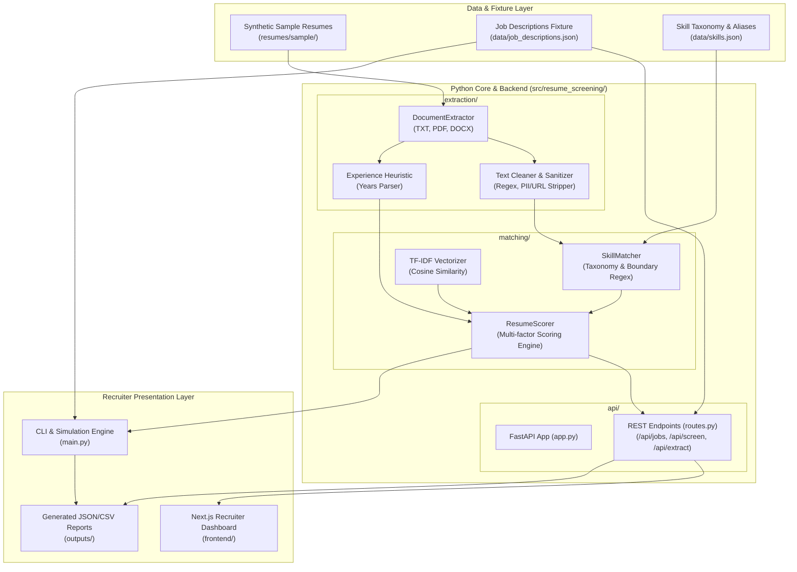

# System Architecture & Technical Design

## 1. Executive Summary
The **Automated Resume Screening Tool** is a decoupled, modern recruitment intelligence platform designed to eliminate manual resume screening friction. It parses multi-format candidate resumes (TXT, PDF, DOCX), matches detected proficiencies against job description criteria, applies a multi-factor scoring algorithm (TF-IDF cosine similarity, skill ontology matching, and experience fit), and presents ranked candidate scorecards via an interactive Next.js recruiter dashboard and FastAPI endpoints.

---

## 2. Target System Architecture

---

## 3. Subsystem Breakdown

### 3.1 Document Ingestion & Extraction Layer
- **Universal Format Handling:** Parses `.txt`, `.pdf`, and `.docx` documents.
- **Resilience Fallbacks:**
  - PDF: Uses `pypdf` or `pdfplumber` if installed, with a built-in pure-Python stream decoder fallback.
  - DOCX: Uses `python-docx` if installed, with a zero-dependency ZIP/XML parser fallback that extracts text directly from `word/document.xml`.
- **Text Normalization:** Strips URLs, emails, phone numbers, and special characters while preserving coding punctuation (e.g. `C++`, `Next.js`).
- **Upload Safety & Resource Ceiling:** Strictly enforces a 5MB maximum file size limit, generates randomized isolated temporary files, and guarantees cleanup on both success and error paths.
- **Robust Experience Parsing:** Unknown experience is cleanly handled as `None` rather than triggering unhandled formatting or calculation exceptions.

### 3.2 Matching & Scoring Layer
- **SkillMatcher:** Normalizes extracted skills through an alias mapping (e.g. `k8s` $\rightarrow$ `Kubernetes`, `nlp` $\rightarrow$ `Natural Language Processing`) and matches against mandatory and preferred skills.
- **ResumeScorer:** Implements a weighted composite scoring framework:
  1. Required Skills (40% weight)
  2. Preferred Skills (20% weight)
  3. TF-IDF Cosine Similarity (25% weight)
  4. Experience Alignment (15% weight)
- **Ranker:** Sorts candidates in descending order of composite score, breaking ties by required skill matches.

### 3.3 Backend API Layer
- **Framework:** FastAPI with Pydantic v2 schemas.
- **CORS Support:** Configured for explicit development origins (`http://localhost:3000`, `http://127.0.0.1:3000`, `http://localhost:3001`, `http://127.0.0.1:3001`) with credentials enabled, strictly avoiding wildcard origins.
- **REST Endpoints:** Includes health checks, job description fixtures, resume upload parsing, batch screening, and report export.

### 3.4 Presentation Layer
- **CLI Runner (`main.py`):** Standalone terminal interface supporting immediate batch screening simulation, API server startup, and single-file analysis.
- **Next.js Recruiter Dashboard (`frontend/`):** Interactive React 18 UI with job profile switcher, real-time candidate scorecards, skill gap badges, and standalone fallback simulation.
