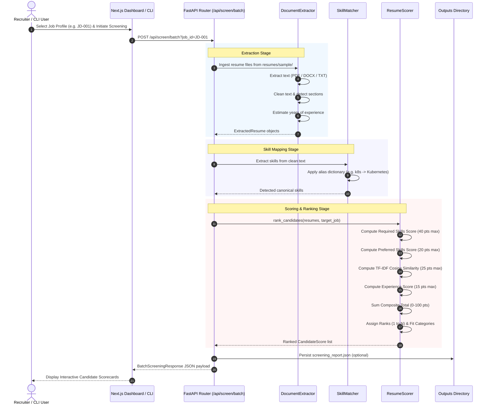

# Data Flow & Pipeline Lifecycle

## 1. End-to-End Sequence Diagram

---

## 2. Stage-by-Stage Data Transformations

| Stage | Input Data | Transformation Applied | Output Data |
| :--- | :--- | :--- | :--- |
| **1. Ingestion** | Raw `.txt`, `.pdf`, `.docx` files | File byte streaming and format decoding | Raw text string `raw_text` |
| **2. Sanitization** | `raw_text` | Regex removal of emails, phone numbers, URLs, and excessive whitespace | Sanitized text `clean_text` |
| **3. Section Parsing** | `raw_text` | Keyword heuristic detection (Experience, Education, Skills, Projects) | `sections_detected: Dict[str, bool]` |
| **4. Experience Inference** | `raw_text` | Pattern matching date ranges (`2019 - Present`) and explicit year statements | `estimated_experience_years: Optional[float]` (`None` if unknown) |
| **5. Skill Extraction** | `clean_text` | Word-boundary regex matching against `skills.json` taxonomy and aliases | `extracted_skills: List[str]` |
| **6. Skill Comparison** | `extracted_skills`, `job.required_skills` | Set-intersection with alias normalization | `SkillMatchBreakdown` (matched vs. missing) |
| **7. TF-IDF Similarity** | `clean_text`, `job.description` | Vector space cosine similarity | TF-IDF text similarity ratio $\in [0.0, 1.0]$ |
| **8. Composite Scoring** | Score components | Multi-factor weighted summation | Composite score $\in [0.0, 100.0]$ |
| **9. Ranking & Output** | Unordered candidates | Descending sort by composite score, tie-break by required skills | Ordered list with ranks and fit badges |
