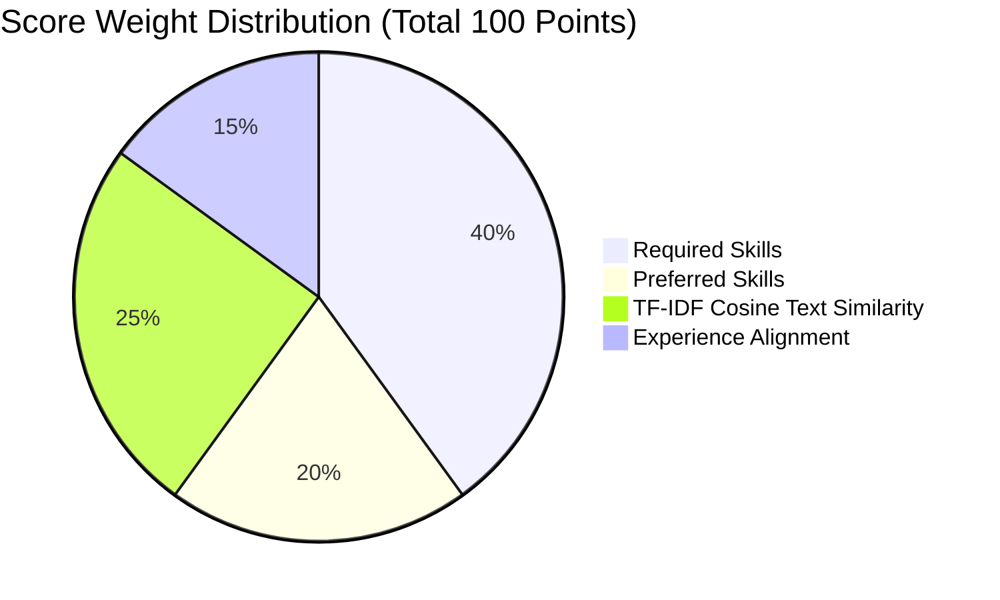

# Scoring Mechanics & Ranking Architecture

## 1. Multi-Factor Evaluation Architecture
Rather than relying purely on keyword counts or dense embeddings that require heavy neural runtime dependencies, the system implements an explainable, multi-factor scoring formula that balances hard skill requirements, preferred skill bonuses, TF-IDF cosine text similarity, and years of professional experience.

---

## 2. Mathematical Formulation

### Factor 1: Required Skills Match Score ($S_{\text{req}}$) — Max 40.0 Points
Measures the proportion of mandatory job skills explicitly detected in the candidate's resume:
$$S_{\text{req}} = \left(\frac{|\mathcal{S}_{\text{cand}} \cap \mathcal{S}_{\text{req\_job}}|}{|\mathcal{S}_{\text{req\_job}}|}\right) \times 40.0$$
Where $\mathcal{S}_{\text{cand}}$ is the set of canonicalized skills detected in the resume, and $\mathcal{S}_{\text{req\_job}}$ is the set of required skills.

### Factor 2: Preferred Skills Match Score ($S_{\text{pref}}$) — Max 20.0 Points
Provides a bonus for candidate proficiencies that match nice-to-have qualifications:
$$S_{\text{pref}} = \left(\frac{|\mathcal{S}_{\text{cand}} \cap \mathcal{S}_{\text{pref\_job}}|}{|\mathcal{S}_{\text{pref\_job}}|}\right) \times 20.0$$

### Factor 3: TF-IDF Cosine Text Similarity ($S_{\text{tfidf}}$) — Max 25.0 Points
Measures lexical and vocabulary overlap between the entire resume document and the job description:
$$\text{Sim}(R, JD) = \frac{\mathbf{v}_R \cdot \mathbf{v}_{JD}}{\|\mathbf{v}_R\|_2 \|\mathbf{v}_{JD}\|_2}$$
$$S_{\text{tfidf}} = \text{Sim}(R, JD) \times 25.0$$
Where $\mathbf{v}_R$ and $\mathbf{v}_{JD}$ are TF-IDF feature vectors constructed using unigrams and bigrams with English stop-word filtering. This provides robust text similarity without requiring heavyweight external neural language models.

### Factor 4: Experience Alignment Score ($S_{\text{exp}}$) — Max 15.0 Points
Evaluates whether the candidate meets the seniority threshold:
$$S_{\text{exp}} = \begin{cases} 
15.0 & \text{if } E_{\text{req}} \le 0 \\
0.0 & \text{if } E_{\text{cand}} \text{ is unknown (None)} \\
\min\left(1.0, \frac{E_{\text{cand}}}{E_{\text{req}}}\right) \times 15.0 & \text{otherwise}
\end{cases}$$
Where $E_{\text{cand}}$ is the candidate's estimated professional experience in years, and $E_{\text{req}}$ is the job requirement. If experience is unstated or cannot be inferred, it is treated gracefully as unknown without crashing, awarding $0.0$ for the experience factor.

---

## 3. Total Composite Score & Fit Categorization

$$\text{Total Score} = S_{\text{req}} + S_{\text{pref}} + S_{\text{tfidf}} + S_{\text{exp}}$$

The final score is bounded in $[0.0, 100.0]$ and categorized into candidate fit tiers:
- **Strong Match:** $\text{Total Score} \ge 75.0\%$
- **Moderate Match:** $50.0\% \le \text{Total Score} < 75.0\%$
- **Weak Match:** $\text{Total Score} < 50.0\%$

### Ranking Algorithm
Candidates are sorted in descending order:
1. Primary key: `Total Score` (descending)
2. Tie-breaker 1: `Required Skills Match Score` (descending)
3. Tie-breaker 2: `TF-IDF Cosine Similarity` (descending)
Ordinals (`Rank 1`, `Rank 2`, ...) are assigned sequentially based on this sorted order.
